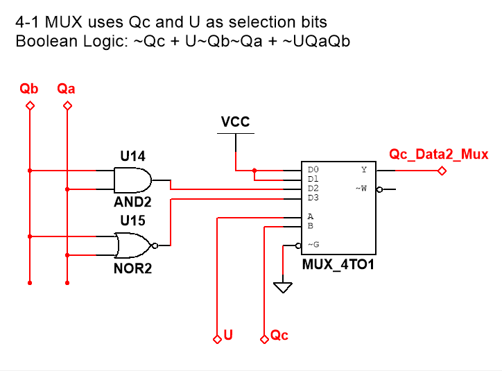
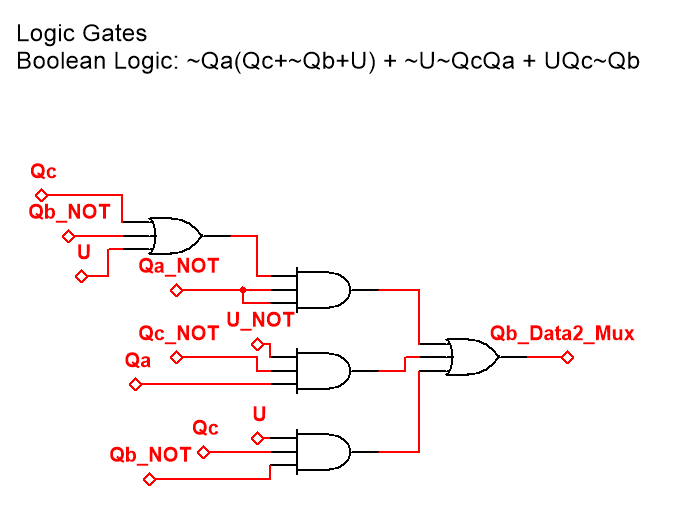
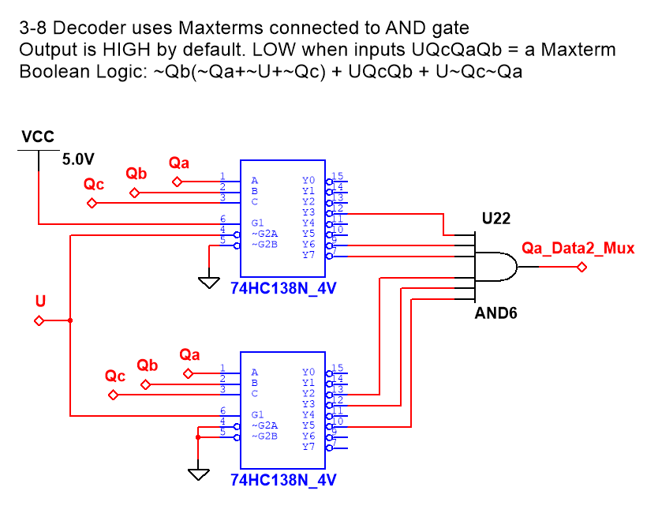
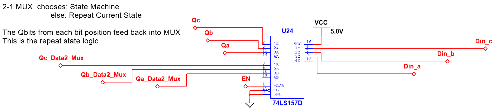

# FSM Design Choices

[← Back to project overview](../README.md)

## Overview

The 3-bit mod-7 up/down FSM follows the custom sequence `7 → 1 → 5 → 2 → 6 → 3 → 4` and reverses that sequence when the direction input changes. The original assignment specified D, SR, and T flip-flop behavior for `Qc`, `Qb`, and `Qa`, respectively.

I derived the excitation equations from the state-transition table, converted the SR and T behavior into equivalent D-input equations, and implemented the state register using three D flip-flops. I then used different approaches to implement the combinational next-state logic for each bit, with the enable function handled separately.

## Qc — 4-to-1 Multiplexer

The next-state equation for `Qc` (MSB) was implemented using a **4-to-1 multiplexer**. By using `Qc` and the direction input `U` as selection signals, the remaining Boolean logic could be placed on the multiplexer data inputs. This provided an alternative to implementing the entire expression with separate AND and OR gates.

## Qb — Standard Logic Gates

The next-state equation for `Qb` (middle bit) was implemented using **combinational gate logic**. After converting the assigned SR excitation behavior to a D-input equation, I simplified the Boolean expression and built the resulting function using standard gates.

This approach allowed the minimized expression to be implemented directly without an additional decoder or multiplexer.

## Qa — Decoder as a Maxterm Generator

The next-state logic for `Qa` (LSB) uses **two 3-to-8 decoders**. The direction input `U` enables one decoder at a time, allowing the up-count and down-count functions to be implemented separately.

Each decoder has **active-low outputs**: the output corresponding to the present-state input combination goes LOW, while the other outputs remain HIGH. These outputs can therefore be treated as Boolean **maxterms**. Selected outputs from the two decoders are combined through an AND gate to produce the required D input for `Qa`.

In product-of-maxterms form, the function is HIGH unless one of the selected maxterms becomes LOW. Using the decoder outputs directly avoided constructing each maxterm from individual gates.

## Enable Control — 74LS157 Multiplexer

The enable input was handled separately from the three next-state equations. A **74LS157 quad 2-to-1 multiplexer** selects either the current state bits or the outputs of the combinational next-state logic.

- **`EN = 0`:** Select the present-state bits (`Qc`, `Qb`, `Qa`), feeding them back to the D inputs so the state holds on the next clock edge.
- **`EN = 1`:** Select the calculated next-state bits so the FSM advances in the direction specified by `U`.

Separating the enable function from the next-state expressions simplified the logic that had to be implemented for each state bit.

## Summary

The final design combines **multiplexer-based logic, minimized standard-gate logic, and decoder-generated maxterms**. These implementations produce the next-state inputs for three D flip-flops, while a separate multiplexer provides the enable/hold function. The design illustrates how the same sequential-logic requirements can be realized through different combinations of TTL components.
