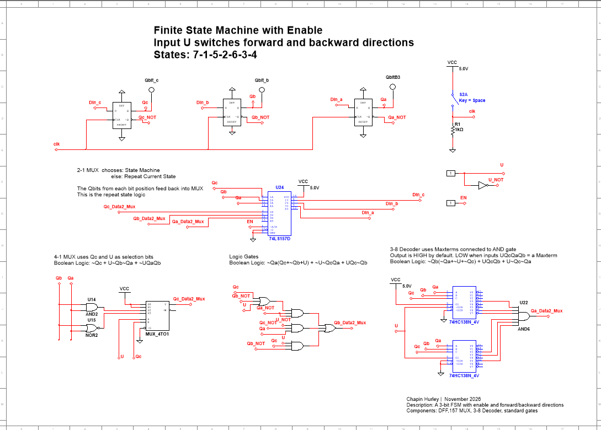

# 3-Bit Mod-7 Up/Down FSM Counter

## The Task

Design and build a **synchronous 3-bit mod-7 up/down Finite State Machine** using 7400-series TTL logic. The FSM must follow a custom seven-state sequence, count in either direction, and include an enable input that holds the current state when disabled.

My assigned sequence was **Case 4**, based on the last digit of my student ID, with the following forward sequence:

**7 → 1 → 5 → 2 → 6 → 3 → 4** (decimal), omitting state `000`.

The design requirements specify a **D flip-flop** for `Qc` (MSB), an **SR flip-flop** for `Qb`, and a **T flip-flop** for `Qa` (LSB).

## The Design

### This is a synchronous 3-bit FSM with a custom counting sequence and enable control  

**Count Up (`u = 1`):** `111 → 001 → 101 → 010 → 110 → 011 → 100 → 111`  
**Count Down (`u = 0`):** `111 → 100 → 011 → 110 → 010 → 101 → 001 → 111`

The original design requirements assigned a **D flip-flop** to `Qc` (MSB), **SR flip-flop** to `Qb`, and **T flip-flop** to `Qa` (LSB). 
Excitation equations were derived for inputs S, R and T. This behavior was converted into equivalent D-input logic. The design was then ready to implement with three DFF memory elements. Three D flip-flops stored the present state (`Qc`, `Qb`, `Qa`). On each active clock edge, the circuit either advances to the next state in the selected direction or holds its current state. 

After the boolean expressions were derived for the Qbits, design choices were made to reduce the overall hardware.
The Enable input was removed from the excitation logic, and instead used as the selection bit for a 74LS157 MUX. 
A **74LS157 quad 2-to-1 multiplexer** selects between the present-state outputs and the calculated next-state bits. When `EN = 0`, the multiplexer feeds the present state back into the D inputs, so the counter holds its state. When `EN = 1`, the next-state logic is selected and the counter advances on the next clock edge.

- **`Qc` (MSB):** 4-to-1 multiplexer (`74LS153`)
- **`Qb` (middle bit):** Combinational gate logic
- **`Qa` (LSB):** 3-to-8 decoder (`74LS138`) with supporting logic

**`u = 1`** → Count Up, **`u = 0`** → Count Down  
**`EN = 1`** → Count, **`EN = 0`** → Hold

For a detailed explanation of the individual circuit implementations, see the [Design Choices](Design_Choices/README.md) documentation.

## Complete Circuit Schematic

## Hardware Demonstration

The completed 3-bit up/down FSM was assembled and tested
using discrete 7400-series logic ICs.

### Circuit Operation

https://github.com/user-attachments/assets/[(https://github.com/user-attachments/assets/992e3848-13ee-44e4-a484-64ddc755f1b5)]

### Manual Clock Operation

https://github.com/user-attachments/assets/https://github.com/user-attachments/assets/a564125d-05b1-44eb-9ffe-0ff19070ab83

## Components

- D flip-flops (`74LS74`)
- Dual 4-to-1 multiplexer (`74LS153`)
- Quad 2-to-1 multiplexer (`74LS157`)
- 3-to-8 decoder (`74LS138`)
- AND, OR, NOT, and other supporting logic gates
- Up/down direction and enable switches
- Manual clock input

## Concepts Demonstrated

### Custom counter design

- Synchronous sequential logic and finite-state-machine design
- Custom up/down state transitions with an omitted state
- Intelligent custom design choices used to minimize hardware
- SR and T flip-flop excitation tables and conversion to D-input equations
- Boolean minimization and combinational logic implementation
- Multiplexer- and decoder-based next-state logic
- Physical TTL circuit construction, testing, and debugging
